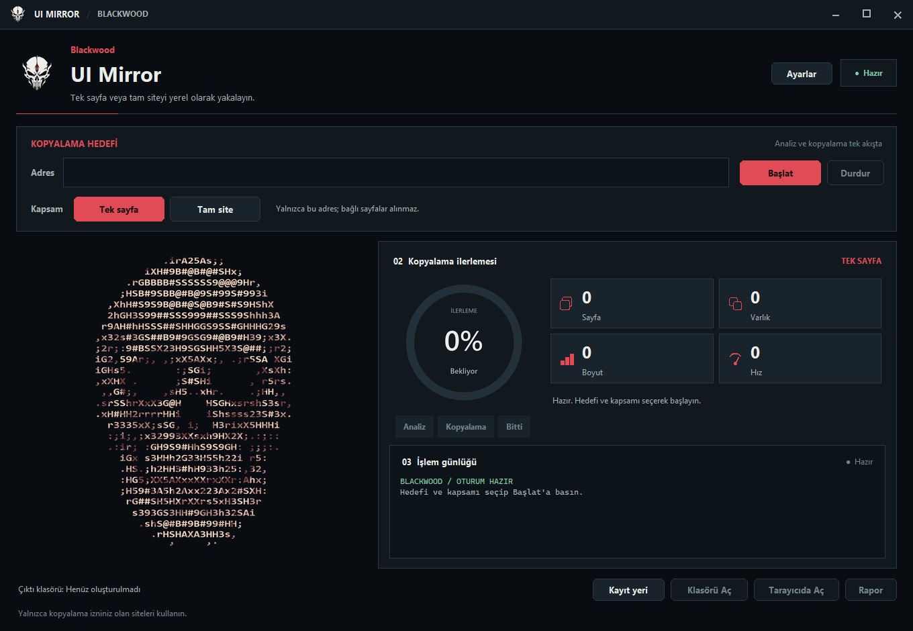
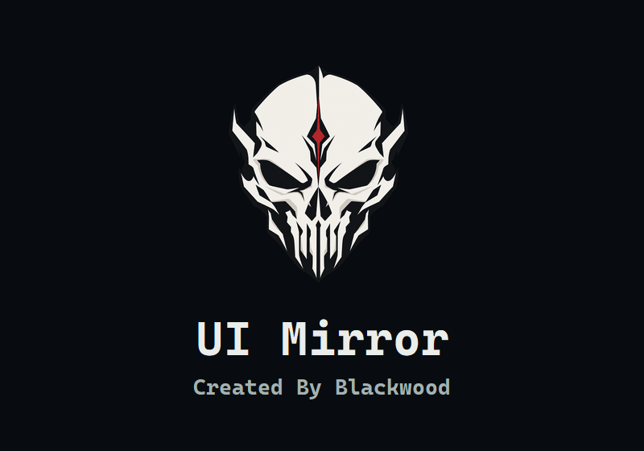

# ui-mirror

**Blackwood UI Mirror 1.9.11** · Kaynak kod yayını

Özgün uygulama kodu MIT lisanslıdır. Üçüncü taraf varlıkların kaynak ve lisans
ayrımı [NOTICE.md](NOTICE.md) içinde açıklanır. Son kaydedilen Setup taraması,
dosya hash'i ve incelemenin sınırları [antivirüs kaydında](docs/antivirus-status.md)
yer alır. Kaynağın açık olması güvenlik garantisi değildir.

Bu depo düzeninde komutları depo kökünden çalıştırın. Python paketi `ui_mirror/`
altındadır; yerel derlemeler ve kişisel ayarlar kaynak yayınına dahil değildir.

Verdiğin URL'den bir sitenin **arayüzünü** indirip, tüm bağlantıları yerel yollara
çevirerek çevrimdışı açılabilir bir kopya üreten HTTrack benzeri araç: Blackwood
imzalı koyu masaüstü arayüzü, yüzdelik canlı ilerleme ve
**kopyalanabilirlik teyidi** ile.



Açılış animasyonu (üst merkezde beliren görsel logo, ardından karakterlerden çözülen iki satır):



Özellikler:

- HTML, CSS, JS, font, görsel, medya, favicon ve manifest indirir; CSS içindeki
  `url(...)` / `@import` zincirlerini, `srcset`, inline `style` ve `<style>`
  bloklarını takip eder. İzin verilen sayfaların gömülü varlıkları, CDN'nin
  tarayıcı robotlarına koyduğu kısıttan bağımsız indirilir; sayfa gezintisi
  robots.txt kurallarını izler.
- Tüm bağlantıları dosya konumuna göre göreli yerel yollara çevirir; kopyalanmayan
  hedefleri canlı `https://` adresine yönlendirir (kırık `/x` bağlantısı kalmaz).
- **Başlat** tek akışta teyit ve kopyalama yapar: HTTP durumu, robots.txt,
  anti-bot, SPA/render ihtiyacı ve varlık erişimi incelenir. Analiz sonuçları
  işlem günlüğüne yazılır, ardından kopyalama otomatik başlar.
- Masaüstü arayüzünde uygulama rengine uyumlu özel pencere üst barı ve
  küçültme, büyütme, kapatma denetimleri vardır. Solda çerçevesiz, kafatası
  görselinden örneklenmiş ve
  yüz hatlarını korurken her karede harf, sayı ve sembolleri değiştiren ASCII
  imza; sağda yumuşak ilerleme halkası, sayaçlar ve işlem günlüğü
  bulunur. **Durdur** analiz sırasında da çalışır. Klasörü, tarayıcıyı ve
  raporu açma düğmeleri ile dar pencerede uyumlu düzen korunur.
- Sade açılışta ayrı görsel Blackwood logosu karanlıktan belirir; rastgele
  harf/sembol/sayılar önce **UI Mirror**, ardından **Created By Blackwood**
  yazılarına dönüşür. İç paneldeki kafatası canlı ASCII olarak kalır.
  Ana penceredeki dikey oranlı kafatası imzası analize, yazmaya,
  kopyalamaya ve hataya renk ve karakter değişimiyle tepki verir; çene sabit kalır.
- Panel imzasına tıklayınca D34D-GPT `public/spy/laugh.ogg` kaydından
  dönüştürülmüş `assets/deadgpt_laugh.wav` oynar.
- Imagegen ile hazırlanan yeni Blackwood logosu şeffaf PNG ve çok çözünürlüklü
  ICO olarak uygulama penceresine, taşınabilir EXE'ye ve kurulum paketine eklenir.

> Yalnızca sahibi olduğun veya kopyalama iznin olan sitelerde kullan.

## Kurulum

```powershell
pip install -r ui_mirror/requirements.txt   # requests + beautifulsoup4 + Pillow
```

Masaüstü arayüzü `tkinter` ve yumuşak çizim için Pillow kullanır.

### Windows EXE ve kurulum

Windows'ta Python kurmadan kullanmak için derlediğiniz `ui_mirror/dist/Blackwood-UIMirror-Portable.exe`
dosyasını çalıştırın. `ui_mirror/dist/Blackwood-UIMirror-Setup.exe` kullanıcı hesabına
kurulur, Başlat menüsü kısayolu ve kaldırıcı oluşturur. Kurulum yönetici yetkisi
istemez. Varsayılan kopyalar `Belgeler/UI Mirror` altında ayrı klasörlere yazılır;
**Kayıt yeri** düğmesiyle başka bir klasör seçilebilir. **Tarayıcıda Aç** yerel
bir HTTP önizlemesi başlatır ve uygulama kapanınca bu sunucuyu durdurur.
Analizden kopyalamaya geçiş etkinlik alanında görünür. İlk sayfa alındığında
**Tarayıcıda Aç** kullanılabilir; varlıklar arka planda inerken ilerleme ve
indirme hızı canlı güncellenir. Kopyalama bitince önizleme yerel varlıklara geçer.
Paketler dijital imzalı değildir; Windows SmartScreen uyarısı gösterebilir.
Kurulum ve kaldırma işlemleri klasör sahipliğini doğrular; kaldırıcı yalnızca
paket manifestindeki dosyaları siler, sonradan eklenen ilgisiz dosyaları korur.
1.9.11'den itibaren farklı bir kurulumun dolu klasörüne yükseltme yapılmaz;
eski sürümden dosya kalmasını önlemek için yeni veya boş bir hedef klasör seçin.
Mevcut kurulumu aynı kurulum dosyasıyla onarmak desteklenir. Eski kurulum ve
sonradan eklenen dosyalar otomatik taşınmaz veya silinmez.
**Ayarlar** penceresinde sayfa/varlık sınırları, eşzamanlı istek, istek aralığı,
zaman aşımı, yeniden deneme ve toplam süre sınırı düzenlenir; ayarlar kullanıcı
profilinde saklanır.

Masaüstü EXE önce HTML'i inceler; boş JavaScript kabuğu veya ana içeriği henüz
yüklenmemiş bir sayfa görürse kurulu Chrome veya Edge ile sayfayı yükler. Tarayıcıda
oluşan görünüm daha fazla içerik taşıyorsa onu kaydeder. Bu davranış **Ayarlar**
penceresinden kapatılabilir. Tarayıcı yoksa boş sayfayı başarı saymaz; raporda
hata nedenini gösterir. CLI `--render` seçeneği de kurulu Chrome/Edge veya
Playwright ile çalışır.

Masaüstü arayüzündeki **Tek sayfa / Tam site** seçimi kapsamı belirler. Tek sayfa
varsayılandır: örneğin `/login.html` verildiğinde bağlantılı sayfalara geçmeden
yalnızca o sayfanın CSS, JS, font ve görsellerini indirir. Tam site, girilen URL'den
başlayıp aynı sitedeki sayfa bağlantılarını izler; Ayarlar'daki sayfa ve süre
sınırlarına uyar. Sınırda bekleyen sayfa kalırsa rapor bunu eksik kopya olarak
gösterir. CLI varsayılanı da tek URL'dir; bağlantıları izlemek için açıkça
`--depth` verilmelidir.

EXE dosyalarını kaynak koddan yeniden üretmek için Windows'ta Python 3.13 x64 ve
NSIS kurulu olmalıdır. Betik ayrı bir derleme ortamı oluşturur; sürümleri ve
SHA-256 değerleri kilitlenmiş bağımlılıkları yükler, ortamı denetler ve çıktı
hash'lerini `ui_mirror/dist/build-manifest.json` içine kaydeder:

```powershell
& .\ui_mirror\packaging\build.ps1
```

JS ile render edilen siteler için isteğe bağlı:

```powershell
pip install playwright
playwright install chromium
```

## Masaüstü arayüzü (GUI)

```powershell
python -m ui_mirror --gui
python -m ui_mirror --gui https://ornek.com      # adres dolu açılır, tek akış otomatik başlar
python -m ui_mirror --gui --no-splash            # açılış animasyonunu atla
```

Akış:

0. **Açılış animasyonu:** Merkezdeki görsel kafatası logosu karanlıktan belirir.
   Altında rastgele karakterler `UI Mirror` ve `Created By Blackwood` yazılarına
   çözülür. Tıkla veya ESC ile atlanır; yaklaşık 4 saniye sürer.
1. Adresi gir, **Tek sayfa** veya **Tam site** kapsamını seç ve **Başlat**'a bas.
2. Uygulama analizi otomatik yapar; skor, kanıtlar ve öneriler işlem günlüğüne
   yazılır. Ardından kopyalama başlar.
3. Halka yüzdeyi akıcı biçimde gösterir; sayfa/varlık/boyut/hız sayaçları
   güncellenir. **Durdur** analiz akışını hemen kapatır ve kopyalamanın açılmasını engeller,
   kopyalama sırasında yazılmış kısmi dosyaları korur.
4. Bittiğinde **Klasörü Aç**, **Tarayıcıda Aç** ve **Rapor** etkinleşir.

Arayüz ayrıca `python -m ui_mirror.gui` ile de açılabilir.

### Tema

Palet `ui_mirror/theme.py` içinde durur: grafit yüzeyler, sıcak beyaz metin,
ölçülü kırmızı vurgu (`#E04B55`) ve durum renkleri. GUI ve açılış animasyonu
bu paleti paylaşır. Kuru kafa işaretinin SVG/PNG renkleri ayrıca asset dosyalarında
tanımlıdır.

## Kopyalanabilirlik teyidi (CLI)

```powershell
python -m ui_mirror https://ornek.com --check
python -m ui_mirror https://ornek.com --check-json > teyit.json
```

Gerçek çıktı örneği:

```
Teyit: https://getbootstrap.com/
Sonuç: 100/100 · Kopyalanabilir - Sayfa kopyalanabilir görünüyor.
HTTP 200 · text/html · cloudflare

[OK]  HTTP 200 · sayfa açılıyor
[OK]  robots.txt sayfayı engellemiyor
        Sitemap tanımlı
[i]   17 sayfa bağlantısı · 12 varlık
[OK]  Varlık erişimi 12/12
        Örneklenen varlıklar indirilebiliyor (~121.6 KB)

Keşfedilen: 17 sayfa bağlantısı · 12 varlık · örneklenen 12 (erişilebilir 12, ~121.6 KB)
Süre: 1.34s
```

Ölçülenler ve anlamı:

| Kontrol | Neye bakar | Sonuç |
| --- | --- | --- |
| Erişim | HTTP 200/301/403/404/429/5xx, yönlendirme | 403/404 → engelli |
| Anti-bot | `cf-mitigated`, Cloudflare/hCaptcha metinleri | doğrulama sayfası → engelli |
| robots.txt | sayfa için `can_fetch`, sitemap | kural varsa uyarı, `--no-robots` yalnızca kendi sitende |
| İndeks sinyali | `X-Robots-Tag: noindex`, `meta robots` | uyarı |
| Render ihtiyacı | boş `#root`/`#app`, `__NEXT_DATA__`, az metin + çok script | `--render` önerilir |
| Giriş duvarı | `input[type=password]`, login formları | `--cookies` önerilir |
| Varlık erişimi | ilk 12 varlığa HEAD isteği | 403/404 oranı skoru düşürür |
| İçerik | `canvas`, WebSocket, video akışı | bilgi notu |

Skor: ≥80 **Kopyalanabilir**, ≥55 **Koşullu**, altı **Kopyalanamaz** (bloklayıcı
durumlarda skordan bağımsız olarak engelli). Çıkış kodu: kopyalanabilir `0`,
engelli `1`.

## Hızlı kullanım

```powershell
python -m ui_mirror https://example.com                # mirror_example.com/ klasörüne indirir
python -m ui_mirror https://example.com --serve        # indirir + http://127.0.0.1:8765 açar
```

`--serve` kopyayı HTTP üzerinden yayınlar ve tarayıcıyı açar (Ctrl+C ile durur).
`file://` yerine HTTP kullanmak, tarayıcıların yerel dosya kısıtlamalarından
(CORS, font, modül) kaynaklanan sorunları büyük ölçüde önler.

## Örnekler

```powershell
# masaüstü arayüz, tek komut
python -m ui_mirror --gui https://docs.ornek.com

# 3 seviye derinlik, en fazla 80 sayfa, kendi klasörüne
python -m ui_mirror https://docs.ornek.com --depth 3 --max-pages 80 -o kopya

# Sadece tek sayfa (arayüz vitrini), CDN varlıkları dahil
python -m ui_mirror https://ornek.com -d 0 -o vitrin

# React/Vue/Next gibi istemci tarafında render edilen site
python -m ui_mirror https://spa.ornek.com --render -d 1

# Yalnızca belirli bölüm: /docs dışına çıkma
python -m ui_mirror https://ornek.com --allow "/docs" -d 2

# Oturum çerezi gereken sayfa
python -m ui_mirror https://panel.ornek.com --cookies "session=abc123" --render
```

## Seçenekler

| Seçenek | Varsayılan | Açıklama |
| --- | --- | --- |
| `url` | — | Başlangıç sayfası |
| `--gui` | kapalı | Animasyonlu masaüstü arayüzünü aç |
| `--no-splash` | kapalı | Açılış animasyonunu atla (GUI ile birlikte) |
| `--check` | kapalı | Kopyalanabilirlik teyidi yap ve çık |
| `--check-json` | kapalı | Teyit raporunu JSON yazdır |
| `-o, --output` | `mirror_<host>` | Çıktı klasörü |
| `-d, --depth` | `0` | Ek bağlantı seviyesi (`0` = yalnızca verilen URL) |
| `--max-pages` | `40` | En fazla sayfa sayısı |
| `--max-assets` | `2000` | En fazla varlık (CSS/JS/görsel/font…) sayısı |
| `--any-host` | kapalı | Ana makine dışındaki sayfaları da gez |
| `--no-external-assets` | kapalı | CDN'lerden varlık indirme |
| `--deny REGEX` | logout/signout/wp-login… | Eşleşen sayfaları atla (tekrarlanabilir) |
| `--allow REGEX` | — | Sadece eşleşen sayfaları indir (tekrarlanabilir) |
| `--render` | kapalı | Sayfaları Playwright veya kurulu Chrome/Edge ile render ettikten sonra al |
| `-j, --jobs` | `4` | Paralel indirme sayısı |
| `--delay` | `0.2` | İstekler arası en az bekleme (sn) |
| `--timeout` | `20` | İstek zaman aşımı (sn) |
| `--retries` | `2` | Başarısız istek için tekrar sayısı |
| `--max-asset-mb` | `25` | Tek bir varlık için üst boyut (MB) |
| `--max-seconds` | `600` | Toplam süre bütçesi (`0` = sınırsız) |
| `--no-robots` | kapalı | Sayfa gezintisinde robots.txt'i yok say (yalnızca sahibi olduğun sitelerde) |
| `--user-agent` | Chrome UA | User-Agent başlığı |
| `--header "Ad: değer"` | — | Yalnızca başlangıç URL'sinin tam kaynağına gönderilen ek HTTP başlığı (tekrarlanabilir) |
| `--cookies "a=b; c=d"` | — | Yalnızca başlangıç URL'sinin tam kaynağına gönderilen çerezler |
| `--serve [PORT]` | `8765` | Kopyayı HTTP ile yayınla ve aç |
| `--open` | kapalı | Bitişte giriş sayfasını varsayılan tarayıcıda aç |
| `-q, --quiet` | kapalı | Sadece özeti yazdır |

Kullanıcının verdiği başlık ve çerezler şema, alan adı ve etkin port eşleşmesine
bağlıdır. Yönlendirme başka alana, alt alana, porta veya HTTP/HTTPS şemasına
geçerse bu bilgiler gönderilmez. Oturum gerektiren bir sayfada son güvenilir
URL'yi başlangıç adresi olarak seçin. `.netrc` dosyasından kendiliğinden kimlik
bilgisi alınmaz; ortamın proxy ve CA ayarları kullanılmaya devam eder.

## Nasıl çalışır

1. **Kuyruk:** Giriş sayfası `depth=0` olarak kuyruğa girer. Sayfalar sırayla
   işlenir; `depth < --depth` iken bulunan bağlantılar `depth+1` ile kuyruğa eklenir.
2. **Sayfa indirme:** HTML indirilir (istenirse Chromium ile render edilir), `<base href>`
   dikkate alınır ve kaldırılır.
3. **Varlık keşfi:** Her etiket ve öznitelik için referanslar toplanır:
   `a/area[href]`, `link[href]`, `script[src]`, `img/source` (`src`, `srcset`, lazy
   nitelikleri), `video[src|poster]`, `audio`, `track`, `iframe`, `use[href]`,
   `object[data]`, `embed[src]`, `style` blokları ve `style="..."`.
4. **İndirme:** Varlıklar `-j` kadar paralel indirilir; her yanıt 25 MB ve
   yanıt başına 120 sn ile sınırlıdır, böylece takılan bir CDN tüm işi kilitlemez.
5. **CSS zinciri:** İndirilen her CSS yeniden yazılır: `url(...)` ve `@import`
   hedefleri de indirilir; döngüsel `@import`'lar korumalıdır.
6. **Yeniden yazma:** Tüm referanslar, dosyanın bulunduğu klasöre göre **göreli**
   yerel yola çevrilir (`../fonts/x.woff2` gibi). Kopyalanmayan hedefler canlı
   `https://` adresine yönlendirilir.
7. **Yazma:** Sayfa UTF-8 yazılır, `<meta charset>` düzeltilir, orijinal CSP meta
   etiketi kaldırılır (yerel kopyayı kilitlemesin diye).

Motor olay akışı (`on_event`) sayesinde ilerleme, hata ve bitiş bilgisi GUI'ye
canlı taşınır; `cancel_event` iptali bir sonraki adımda keser.

### Dosya adları

- Sayfalar: `/` → `index.html`, `/about` → `about.html`, `/blog/post` → `blog/post.html`
- Varlıklar: URL yolundaki ad korunur, uzantı yoksa `Content-Type`'tan türetilir
  (`/css/app` + `text/css` → `css/app.css`)
- Çakışan adlar URL hash'i ile ayrılır: `logo__1a2b3c4d.png`
- Sorgu dizeleri dosya adına yazılmaz; aynı yolun farklı sorguları hash ile ayrışır

## Çıktı

```
mirror_example.com/
├── index.html
├── mirror-report.json
├── static/…            # orijinal site yapısı korunur
└── docs/6.0/…
```

`mirror-report.json` her sayfanın/varlığın URL'sini, yerel yolunu, HTTP
durumunu, boyutunu ve hata nedenini içerir.

## Sınırlar

- **JS ile üretilen içerik:** Masaüstü uygulaması boş kabuğu tarayıcıda yükleyip
  DOM görünümünü kaydeder. Tarayıcı yoksa açık hata verir. Sayfa içi `fetch`/XHR
  ile sonradan gelen veriler ve sonsuz kaydırma tam yakalanmaz.
- **JS içindeki gömülü URL'ler:** JS dosyaları yeniden yazılmaz; dinamik
  istek yolları çevrimdışı çalışmayabilir.
- **Formlar ve POST istekleri:** Sunucu mantığı kopyalanmaz. Formlar orijinal
  adrese istek gönderebilir; oturum açma çevrimdışı çalışmaz.
- **WebSocket, video akışı, canvas/WebGL:** Tamamen çevrimdışı çalışması beklenmez.
- **Kimlik doğrulama:** Çerez/başlık verilmezse oturum arkasındaki sayfalar gelmez.
- **Boyut/süre sınırları:** Büyük dosyalar (`--max-asset-mb`) ve toplam süre
  (`--max-seconds`) bilerek sınırlıdır; rapor dosyasında nedeni yazar.
- **Cloudflare/403:** Bazı siteler otomatik istemcileri engeller; `--check`
  bunu önceden bildirir, farklı `--user-agent` deneyebilirsin.

## Geliştirme

Depo kökünden testleri çalıştırmak için:

```powershell
python -m unittest discover -s ui_mirror/tests -q
```

Kurulum testleri Windows ve NSIS gerektirir. İlgili ortam veya sembolik bağlantı
yetkisi bulunmadığında bu testler atlanabilir.

```
ui_mirror/
├── __init__.py     # paket API'si, sürüm
├── __main__.py     # python -m ui_mirror
├── cli.py          # argparse, --check, --serve, --gui yönlendirmesi
├── check.py        # kopyalanabilirlik teyidi (skor + kanıtlar)
├── fetcher.py      # HTTP: başlıklar, robots.txt, hız sınırı, boyut/süre koruması
├── localmap.py     # URL → yerel yol eşlemesi, çakışma çözümü
├── rewrite.py      # CSS/HTML yeniden yazma (url(), @import, srcset, charset)
├── mirror.py       # gezinme, varlık toplama, ilerleme olayları, rapor
├── gui.py          # animasyonlu Tkinter arayüzü
├── desktop.py      # Windows EXE başlangıcı ve paket kontrolü
├── intro.py        # görsel logolu açılış animasyonu (scramble)
├── windowchrome.py # özel pencere üst barı ve denetimler
├── signature.py    # canlı panel ASCII'si ve kahkaha sesi
├── preview.py      # yalnızca yerel ağda HTTP önizleme
├── settings.py     # doğrulanan ve saklanan kopyalama ayarları
├── theme.py        # palet ve renk yardımcıları
├── render.py       # Playwright veya kurulu Chrome/Edge ile render
├── packaging/      # PyInstaller derleme ve NSIS kurulum betikleri
└── assets/         # ASCII kareleri, panel kafatası kaynağı, ses ve simge
```

Arayüz görselleri ve antivirüs kaydı depo kökündeki `docs/` klasöründedir.

```powershell
python -m ui_mirror --help
python -m ui_mirror https://example.com -d 0 -o .tmp/smoke -q
python -m ui_mirror https://example.com --check
```

Modül olarak kullanmak:

```python
from pathlib import Path
from ui_mirror import MirrorOptions, SiteMirror

mirror = SiteMirror(
    MirrorOptions(start_url="https://example.com", output_dir=Path("kopya"), max_depth=1),
    on_event=lambda event: print(event["kind"]),
)
report = mirror.run()
print(report.entry_file, len(report.pages), len(report.errors))
```
